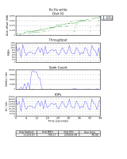
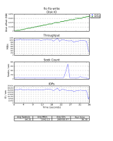

# Kernel Log: Coming in 2.6.32 (Part 3) - Storage

**Chris von Eitzen**

####  by Thorsten Leemhuis

**The kernel development team have enhanced various aspects of Btrfs, one effect of which is to significantly improve the experimental file system's write performance. A number of changes to the block layer promise better data throughputs and reactivity. There are also several new drivers for storage hardware.**

Linux kernel 2.6.32-rc7 [hit the streets](http://thread.gmane.org/gmane.linux.kernel/913403) late last week, but when 2.6.32 will finally be released remains anyone's guess. There are likely to be at least one, more likely two, further pre-release versions in this development cycle, a cycle which has been slightly disrupted by [typos](../site/news/item/Kernel-Log-Improved-USB-3-0-support-X-org-drivers-to-move-back-into-X-Server-819872.html "Kernel Log - Improved USB 3. 0 support, X.org drivers to move back into X Server – 07 October 2009, 16:18") and the [Kernel Summit](../site/news/item/Kernel-Log-Discussions-at-the-2009-Kernel-Summit-FatELF-in-the-firing-line-new-graphics-drivers-850044.html " Kernel Log - Discussions at the 2009 Kernel Summit, FatELF in the firing line, new graphics drivers – 04 November 2009, 13:44"). Following on from our reviews of the changes in the [networking](../site/news/item/Kernel-Log-Coming-in-2-6-32-Part-1-Network-subsystem-and-network-drivers-832229.html "Kernel Log: Coming in 2.6.32 (Part 1) – Network subsystem and network drivers – 19 October 2009, 13:50") and [graphics hardware](../site/news/item/Kernel-Log-Coming-in-2-6-32-Part-2-Graphics-858783.html "Kernel Log: Coming in 2.6.32 (Part 2) - Graphics – 12 November 2009, 18:00") subsystems, this instalment of the Kernel Log 2.6.32 series looks at file systems and storage.

### Btrfs

There have been a whole heap of changes to Btrfs. The experimental "next generation file system for Linux" [can now write](http://thread.gmane.org/gmane.comp.file-systems.btrfs/3710) at more than 1 GB per second on fast hardware and now matches XFS for speed on our test system. Btrfs' previous maximum data transfer speed was 400 MB per second, as this maxed out CPU usage. Snapshots and subvolumes can now be renamed in Btrfs and can be [deleted much more rapidly](http://git.kernel.org/linus/1c4850e21df8b441164d910bc611ef46a01d5d75). Thanks to [various enhancements](http://git.kernel.org/linus/257c62e1bce03e5b9f3f069fd52ad73a56de71fd), RPM and Yum now also work faster.

For delayed allocations, Btrfs is now [more reliable](http://git.kernel.org/linus/9ed74f2dba6ebf9f30b80554290bfc73cc3ef083) in reserving enough space for metadata, ensuring that sufficient capacity is available for subsequent writes. There is some new [experimental code](http://git.kernel.org/linus/e244a0aeb6a599c19a7c802cda6e2d67c847b154) for 'discard operations' which should eventually allow the file system to tell SSDs which blocks have been freed by deleting data – however the requisite support in the SCSI and Libata subsystems is still a work in progress.

A list of further Btrfs-related changes can be found at the end of this article and in various git pull requests in which Chris Mason, the main Btrfs developer, briefly explains the major changes ([1](http://thread.gmane.org/gmane.comp.file-systems.btrfs/3710), [2](http://thread.gmane.org/gmane.comp.file-systems.btrfs/3769), [3](http://thread.gmane.org/gmane.comp.file-systems.btrfs/3857)). Mason, who works for Oracle, developed many of the changes himself, with many more contributed by other developers on the payrolls of various different companies. The importance of this kind of distribution of developer resources and know-how for a successful, resilient open source project was recently emphasised [in a talk given at the Linux Kongress](../site/open/features/Linux-Kongress-2009-New-filesystems-optimised-programming-852084.html "Linux-Kongress 2009: New filesystems, optimised programming – 06 November 2009, 15:14") by Theodore Ts'o ('tytso') (well-known for his work on the Ext file systems).

### Ext3, Ext4, XFS, etc.

Other significant chances to the Linux kernel file system code:

- Numerous changes to Ext3 und Ext4 have made their way into the main development tree via Theodore Ts'o ([1](http://thread.gmane.org/gmane.comp.file-systems.ext4/15585), [2](http://thread.gmane.org/gmane.comp.file-systems.ext4/15679)). [One of them](http://git.kernel.org/linus/0e3d2a6313d03413d93327202a60256d1d726fdc) speeds up the fs_mark benchmark by around fifty per cent under certain set-ups. 'Data=guarded' mode in Ext3, long under development, has once more been left out in the cold.
- Sysfs [now supports](http://git.kernel.org/git/?p=linux/kernel/git/torvalds/linux-2.6.git;a=commitdiff;h=ddd29ec6597125c830f7badb608a86c98b936b64) security labels, allowing security frameworks such as SELinux to monitor access to the virtual file system.
- The kernel's VFAT code will not mount FAT drives by default with the behaviour activated by the "shortname=lower" option, [but will instead now default to use](http://git.kernel.org/linus/955234755ce4a2c33cfc558912aa8f2148cc1fc6) "shortname=mixed". This should mean that upper and lower case in file names will no longer be changed when copying using Linux.
- [Support for](http://git.kernel.org/linus/60e78d2c993e58d890596d951fff77d5965adcd6) the 9p file system has been added in Fscache.
- [A change to XFS](http://git.kernel.org/linus/bd169565993b39b9b4b102cdac8b13e0a259ce2f) should make finding free inodes three to four times faster in certain situations. An overview of further developments in XFS can be found in the XFS status updates for [September](http://thread.gmane.org/gmane.linux.kernel/902294) and [October](http://thread.gmane.org/gmane.linux.kernel/913224).

### Block layer

The CFQ (Completely Fair Queuing) I/O scheduler used by many distributions now optimises queries for short response times. This should mean that when programs are running in the background which process large volumes of data, desktop applications running in the foreground will no longer be slowed to the same extent and will consequently feel faster. Background on the changes can be found in a piece by block subsystem maintainer Jens Axboe [on LWN.net](http://lwn.net/Articles/355987/). The new behaviour does, however, cause some patterns of access to work a little slower, for which reason CFQ's low latency mode can also be [deactivated](http://thread.gmane.org/gmane.linux.kernel/900461/focus%3D900483) via sysfs.

  Benchmarks: Before... Axboe has also introduced a major [rewrite of the writeback infrastructure](http://thread.gmane.org/gmane.linux.kernel/888279), the fruit of several months work, as a result of which each device is now dealt with by its own thread. This and other changes should significantly increase data throughput for writeback-intensive access scenarios and cause them to run more evenly. Axboe includes two benchmark graphics and various measurements in his commit comments to underline the point. More measurements are detailed in [an email from Chris Mason](http://thread.gmane.org/gmane.linux.kernel/892761/focus%3D893491). Some background information on the changes can be found in [a presentation by Axboe](http://oss.oracle.com/~axboe/lpc2009.pdf) and the [April LWN.net](http://lwn.net/Articles/326552/) also has an article on the recently merged [blk-iopoll](http://git.kernel.org/linus/5e605b64a183a6c0e84cdb99a6f8acb1f8200437), which describes the NAPI-like approach to accessing storage devices which aims to increase maximum throughput by reducing IRQs.

  ...and after.

Axboe's [main git pull request](http://thread.gmane.org/gmane.linux.kernel/888236) lists a number of further changes in the block subsystem. Following a long discussion of its pros and cons, replication solution DRBD (Distributed Replicated Block Device) has not made it into Linux 2.6.32, but Torvalds has [signalled](http://thread.gmane.org/gmane.linux.kernel/895997/focus%3D896598) his willingness to merge it into 2.6.33.

### Libata, drivers, etc.

- It will in future be possible to [read](http://git.kernel.org/git/?p=linux/kernel/git/torvalds/linux-2.6.git&a=commitdiff&h=77cdec1ad527560b59ab8dbb063dbb3d0a138bf7) certain information on AHCI capabilities – such as whether a port is hot-pluggable or is an eSATA connector – via sysfs. Userspace applications should be able to use this information to make better decisions on optimal behaviours, e.g. when configuring ALPM (Aggressive Link Power Management).
- The kernel development team has merged the [pata_atp867x](http://git.kernel.org/git/?p=linux/kernel/git/torvalds/linux-2.6.git;a=commitdiff;h=d15d6e6cc340566d53d953ffdec2c9e96816fa52) driver for the ARTOP/Acard ATP867X PATA adapter and the [pata_rdc](http://git.kernel.org/git/?p=linux/kernel/git/torvalds/linux-2.6.git;a=commitdiff;h=6b406782ad0408f9cb480c2e1b543d194e8206d0) driver for RDC PATA adapters. These now include [support](http://git.kernel.org/linus/e2dd90b1ad4c61ecb52f2424049d91ce6ccc1f17) for AMD's SB900 southbridge, which, as things stand at present, still looks several months away from a release date.
- A 1.4 MB patch for the [bfa driver](http://git.kernel.org/linus/7725ccfda59715ecf8f99e3b520a0b84cc2ea79e) for Brocade FC and FCOE host adapters has been merged into the SCSI subsystem. Much more lightweight are the new [be2iscsi](http://git.kernel.org/linus/6733b39a1301b0b020bbcbf3295852e93e624cb1) driver for iSCSI functionality for ServerEngines' 10Gbps BladeEngine 2 storage adapter and [pmcraid](http://git.kernel.org/?p=linux/kernel/git/torvalds/linux-2.6.git;a=commit;h=89a3681041507773dfee1b88c1c90c8a811a79d3) driver for PMC Sierra's MaxRAID series 6Gb/s SAS adapters. There have also been numerous changes to the SCSI subsystem's FCOE driver.
- There have been [a number of changes](http://thread.gmane.org/gmane.linux.kernel/893854) to the MD code and other kernel subsystems to improve the ability to offload calculations for RAID 6 to dedicated hardware. There have also been changes to the still fresh MD code for supporting the various options for modifying and converting software RAID arrays – e.g. for converting a RAID 1 to a RAID 5, to a RAID 6 and back again. Such conversions can be carried out by mdadm versions 3.1.x. The developer responsible for the kernel MD code and mdadm has [withdrawn](http://thread.gmane.org/gmane.linux.raid/25205) the first such version, but has indicated that 3.1.1 should be out shortly. He has also developed several enhancements to the kernel code responsible for modifying and converting RAID arrays, which should find their way into 2.6.33.

### Minor Gems

Many further minor, but by no means insignificant, changes can be found in the list below. Like many of the references in the text above, the links point to the relevant commits in the [web front end](http://git.kernel.org/?p=linux/kernel/git/torvalds/linux-2.6.git;a=summary) of the Git branch at kernel.org that Linus Torvalds uses for maintaining the kernel sources. There, the commit comments and the patches themselves provide extensive further information on the respective changes.

### Filesystems

*Btrfs*

- [Btrfs: add snapshot/subvolume destroy ioctl](http://git.kernel.org/linus/76dda93c6ae2c1dc3e6cde34569d6aca26b0c918)
- [Btrfs: always pin metadata in discard mode](http://git.kernel.org/linus/444528b3e614f7f2391488d9bca8e0b872db909b)
- [Btrfs: cache values for locking extents](http://git.kernel.org/linus/2c64c53d8d30d43d0670482503a3914dfd3d6d46)
- [Btrfs: change how subvolumes are organized](http://git.kernel.org/linus/4df27c4d5cc1dda54ed7d0a8389347f2df359cf9)
- [Btrfs: check size of inode backref before adding hardlink](http://git.kernel.org/linus/a57195214358b75807a74bad96a8601a36262af7)
- [Btrfs: find ideal block group for caching](http://git.kernel.org/linus/ccf0e72537a9f68611ca575121afd08e2b4d0fb0)
- [Btrfs: improve async block group caching](http://git.kernel.org/linus/11833d66be94b514652466802100378046c16b72)
- [Btrfs: only write one super copy during fsync](http://git.kernel.org/linus/4722607db6a78bd7748c51fa4c8d7371da797254)
- [Btrfs: optimize fsync for the single writer case](http://git.kernel.org/linus/ff782e0a131c7f669445c07fe5c7ba91e043b7ed)
- [Btrfs: reduce CPU usage in the extent_state tree](http://git.kernel.org/linus/1edbb734b4e010974c41d2859d22a43d04f5f1cf)
- [Btrfs: streamline tree-log btree block writeout](http://git.kernel.org/linus/690587d109ffe19d6743e4cc80c18b0906b7f9ff)
- [Btrfs: Use CONFIG_BTRFS_POSIX_ACL to enable ACL code](http://git.kernel.org/linus/3baf0bed0a5adab95c7599d2f27124c74692ef28)

*Ext3, Ext4*

- [ext3: Add locking to ext3_do_update_inode](http://git.kernel.org/linus/4f003fd32bc54ec438b8691795279844df27ce38)
- [ext3: Update documentation about ext3 quota mount options](http://git.kernel.org/linus/6dbce5218298c0c77a740b3ffe97cb8c304e1710)
- [ext3: Update MAINTAINERS for ext3 and JBD](http://git.kernel.org/linus/19003c18e9b41f5c3aeb81c92356f90958e1f22f)
- [ext4: Add configurable run-time mballoc debugging](http://git.kernel.org/linus/6ba495e9259cd9a0b40ebd6c315143535c92542f)
- [ext4: Add new tracepoint: trace_ext4_da_write_pages()](http://git.kernel.org/linus/b3a3ca8ca0c3c29abc5b2bfe94bb14f3f4590df9)
- [ext4: async direct IO for holes and fallocate support](http://git.kernel.org/linus/8d5d02e6b176565c77ff03604908b1453a22044d)
- [ext4: drop ext4dev compat](http://git.kernel.org/linus/f0e2dfa7f3e1361ca8fc91c25e67fc4e92613cc9)
- [ext4: Fix memory leak fix when mounting an ext4 filesystem](http://git.kernel.org/linus/024eab4d5bf7e3168a2b71038b3e04e6b1f376ed)
- [ext4: limit block allocations for indirect-block files to \< 232](http://git.kernel.org/linus/fb0a387dcdcd21aab1b09ee7fd80b7c979bdbbfd)
- [ext4: Split uninitialized extents for direct I/O](http://git.kernel.org/linus/0031462b5b392f90d17f1d75abb795883c44e969)
- [ext4: Update documentation about quota mount options](http://git.kernel.org/linus/1358870deaf11a752a84fbd89201749aa62498e8)
- [ext4: Update documentation about quota mount options](http://git.kernel.org/linus/8365388827663bd6fb773e3623ed9023c0f82b1d)
- [ext4: Use tracepoints for mb_history trace file](http://git.kernel.org/linus/296c355cd6443d89fa251885a8d78778fe111dc4)
- [jbd2: Use tracepoints for history file](http://git.kernel.org/linus/bf6993276f74d46776f35c45ddef29b981b1d1c6)

*Others*

- [9p: Update documentation to add fscache related bits](http://git.kernel.org/linus/f4edeeb3937d5f9953b5722f1cca9573d5ffe8a0)
- [CIFS: Re-enable Lanman security](http://git.kernel.org/linus/20d1752f3d6bd32beb90949559e0d14a0b234445)
- [doc/filesystems: more mount cleanups](http://git.kernel.org/linus/16c01b20ae0572d5a1fe8059f1b4c09f79b73cbf)
- [doc/filesystems: remove smount program](http://git.kernel.org/linus/0288b95b432b88f9daf895b526f64beeaca9ac73)
- [Documentation: update stale definition of file-nr in fs.txt](http://git.kernel.org/linus/bcadbbd4c896c80c263c35ce94b763e5ff58cecd)
- [fs/inode.c: add dev-id and inode number for debugging in init_special_inode()](http://git.kernel.org/linus/af0d9ae811d11de8a01d6bc922c5e062be01bd7f)
- [fs/Kconfig: move nilfs2 outside misc filesystems](http://git.kernel.org/linus/41f4db0f48c72db3a93cc1a0b18368d9a9aca700)
- [GFS2: Add a document explaining GFS2's uevents](http://git.kernel.org/linus/0aa87445842036f88b53db7f377ad8376bd94ab8)
- [GFS2: Add "-o errors=panic](http://git.kernel.org/linus/d34843d0c4a20872f3f3bfb510328bd043b939ff)
- [GFS2: Add sysfs link to device](http://git.kernel.org/linus/31e54b01f3f00b595aac02e887960e5dcc575844)
- [inotify: deprecate the inotify kernel interface](http://git.kernel.org/linus/cdc321ff0af78e818c97d4787f62bf52bdf9db2a)
- [NFS: Add a dns resolver for use with NFSv4 referrals and migration](http://git.kernel.org/linus/e571cbf1a4f8d8b6cfd4898df718dae84c75a8e1)
- [NFS: Allow the "nfs" file system type to support NFSv4](http://git.kernel.org/linus/764302ccb88dd0df062eccd507b6c6de24f1c560)
- [nfsd41: sunrpc: Added rpc server-side backchannel handling](http://git.kernel.org/linus/4cfc7e6019caa3e97d2a81c48c8d575d7b38d751)
- [nfsd: revise 4.1 status documentation](http://git.kernel.org/linus/285a0f00c27a02f1223a198c88de2130e9bab059)
- [NFS: Fix port and mountport display in /proc/self/mountinfo](http://git.kernel.org/linus/f5855fecda65c1965c894915ace1e086d4925154)
- [NFSv4: Disallow 'mount -t nfs4 -overs=2' and 'mount -t nfs4 -overs=3'](http://git.kernel.org/linus/2ecda72b49a0849ce41e7fa1fa974a245b9119f8)
- [ocfs2: Add CoW support.](http://git.kernel.org/linus/6f70fa519976a379d72781d927cf8e5f5b05ec86)
- [ocfs2: Add CoW support for xattr.](http://git.kernel.org/linus/492a8a33e1cb966fa0b5756c5fc11d30c8f8848e)
- [ocfs2: Add ioctl for reflink.](http://git.kernel.org/linus/bd50873dc725a9fa72592ecc986c58805e823051)
- [ocfs2: Add preserve to reflink.](http://git.kernel.org/linus/0fe9b66c65f3ff227da45381afe7612f91e32740)
- [ocfs2: Add reflink support for xattr.](http://git.kernel.org/linus/2999d12f4d5529b282ce201b21444590c3f9f723)
- [ocfs2: Add support for incrementing refcount in the tree.](http://git.kernel.org/linus/e73a819db9c2d6c4065b7cab7374709b6939e8f1)
- [SUNRPC: convert some sysctls into module parameters](http://git.kernel.org/linus/cbf1107126af2950623fafdaa5c9df43ab00f046)
- [UBIFS: kill BKL](http://git.kernel.org/linus/e9d6bbc428bdf0c08bbd0b3f28db2b7317cfff21)
- [vfat: change the default from shortname=lower to shortname=mixed](http://git.kernel.org/linus/955234755ce4a2c33cfc558912aa8f2148cc1fc6)
- [vfs: allow file truncations when both suid and write permissions set](http://git.kernel.org/linus/939a9421eb53d3ea83188ae13802779041caefdb)
- [xfs: Record new maintainer information](http://git.kernel.org/linus/f08a59f1467b92cd9b8c78961506f69c74bb01a5)

### Storage

*Block*

- [block: enable rq CPU completion affinity by default](http://git.kernel.org/linus/01e97f6b897bf06ec83375d691f2f4d57f5b3a09)
- [cfq-iosched: add a knob for desktop interactiveness](http://git.kernel.org/linus/1d2235152dc745c6d94bedb550fea84cffdbf768)
- [cfq-iosched: drain device queue before switching to a sync queue](http://git.kernel.org/linus/5ad531db6e0f3c3c985666e83d3c1c4d53acccf9)

*Libata*

- [ahci: Add the AHCI controller Linux Device ID for NVIDIA chipsets.](http://git.kernel.org/linus/726206f84c67303cc004aacfd45d37f9277a29f6)
- [ahci / atiixp / pci quirks: rename AMD SB900 into Hudson-2](http://git.kernel.org/linus/5deab536654f95345ea11e8ec6ed5c778df348b5)
- [ahci: display all AHCI 1.3 HBA capability flags (v2)](http://git.kernel.org/linus/4c521c8ef0e802f88f1d80352dd1b3d6a6aa1cc8)
- [ahci: Enable SB600 64bit DMA on MSI K9A2 Platinum v2](http://git.kernel.org/linus/e65cc194f7628ecaa02462f22f42fb09b50dcd49)
- [ahci: filter FPDMA non-zero offset enable for Aspire 3810T](http://git.kernel.org/linus/f80ae7e45a0e03da188494c6e947a5c8b0cdfb4a)
- [ahci: Gigabyte GA-MA69VM-S2 can't do 64bit DMA](http://git.kernel.org/linus/1b549dcbf607e88f3016bc149109472a46fe7bbb)
- [ahci: make ahci_asus_m2a_vm_32bit_only() quirk more generic](http://git.kernel.org/linus/03d783bf5573ff316a8c703eed811a9a97901a8b)
- [libata: add command name parsing for error output](http://git.kernel.org/linus/6521148c6449724c3b707820b9c535c7e8b8afcd)
- [libata: add DMA setup FIS auto-activate feature](http://git.kernel.org/linus/388539f3ff0cf1de926b03f94e1eec112358f74d)
- [libata: implement more acpi filtering options](http://git.kernel.org/linus/fa5b561c4ea170caf9759109acc2e961a7e83bea)
- [libata: remove spindown skipping and warning](http://git.kernel.org/linus/051d9fbdd1d1ec85ea18ba20581234cf23f1c217)
- [pata_amd: do not filter out valid modes in nv_mode_filter](http://git.kernel.org/linus/90950a2504b66d626a73f55ca949a2e79ff4b7c4)
- [pata_atp867x: add Power Management support](http://git.kernel.org/linus/7affb32a32eabbbe42d6746923ec1d0bf7327234)
- [pata_cs5535: add pci id for AMD based CS5535 controllers](http://git.kernel.org/linus/02cb009bb942007b76c38da4cc2ca0a0a974c667)
- [sata_promise: disable hotplug on 1st gen chips](http://git.kernel.org/linus/0ae6654da437db4ae6333d232e718b570c7a3eac)
- [sata_promise: update reset code](http://git.kernel.org/linus/ff7cddf59e3618d29e12b061651ab3f5a53f4a98)

*MD*

- [async_tx: add sum check flags](http://git.kernel.org/linus/ad283ea4a3ce82cda2efe33163748a397b31b1eb)
- [async_tx: add support for asynchronous GF multiplication](http://git.kernel.org/linus/b2f46fd8ef3dff2ab30f31126833f78b7480283a)
- [async_tx: add support for asynchronous RAID6 recovery operations](http://git.kernel.org/linus/0a82a6239beecc95db6e05fe43ee62d16b381d38)
- [async_tx: kill ASYNC_TX_DEP_ACK flag](http://git.kernel.org/linus/88ba2aa586c874681c072101287e15d40de7e6e2)
- [async_tx: raid6 recovery self test](http://git.kernel.org/linus/cb3c82992f62f838e6476a0bff12909158007fc6)
- [async_tx: rename zero_sum to val](http://git.kernel.org/linus/099f53cb50e45ef617a9f1d63ceec799e489418b)
- [async_tx: structify submission arguments, add scribble](http://git.kernel.org/linus/a08abd8ca890a377521d65d493d174bebcaf694b)
- [async_xor: permit callers to pass in a 'dma/page scribble' region](http://git.kernel.org/linus/04ce9ab385dc97eb55299d533cd3af79b8fc7529)
- [dmaengine: add fence support](http://git.kernel.org/linus/0403e3827788d878163f9ef0541b748b0f88ca5d)
- [dmaengine, async_tx: add a "no channel switch" allocator](http://git.kernel.org/linus/138f4c359d23d2ec38d18bd70dd9613ae515fe93)
- [dmaengine: sh: Add Support SuperH DMA Engine driver](http://git.kernel.org/linus/d8902adcc1a9fd484c8cb5e575152e32192c1ff8)
- [dmatest: add pq support](http://git.kernel.org/linus/58691d64c44ae41ddf098ecb31e9a994026e3cff)
- [fsldma: Add DMA_SLAVE support](http://git.kernel.org/linus/bbea0b6e0d214ef1511b9c6ccf3af26b38f0af7d)
- [ioat2+: add fence support](http://git.kernel.org/linus/128f2d567f906d38b11d993d8d97b9b988848e26)
- [ioat3: split ioat3 support to its own file, add memset](http://git.kernel.org/linus/bf40a6869c9198bdf56fe173961feb89e9f0d961)
- [ioat: add 'ioat' sysfs attributes](http://git.kernel.org/linus/5669e31c5a4874f1634bc0ffba268a6e2fa0cdd2)
- [iop-adma: P+Q support for iop13xx adma engines](http://git.kernel.org/linus/7bf649aee8ac93ecc280f8745dcf8ec19d7b9fb1)
- [md/raid456: distribute raid processing over multiple cores](http://git.kernel.org/linus/07a3b417dc3d00802bd7b4874c3e811f0b015a7d)
- [md/raid5,6: add percpu scribble region for buffer lists](http://git.kernel.org/linus/d6f38f31f3ad4b0dd33fe970988f14e7c65ef702)
- [md/raid5: make sure curr_sync_completes is uptodate when reshape starts](http://git.kernel.org/linus/8dee7211467a56b7eb4e4359efb0aa4a72e1b6f3)
- [md/raid6: asynchronous raid6 operations](http://git.kernel.org/linus/ac6b53b6e6acab27e4f3e2383f9ac1f0d7c6200b)

*MFD*

- [mfd: Add basic WM831x OTP support](http://git.kernel.org/linus/6704e5171ba9053ba173bcd807c7392d2076bdb4)
- [mfd: Add Freescale MC13783 driver](http://git.kernel.org/linus/8238addcc52c94c59b10c3c1e9850d3a7921f825)
- [mfd: Add support for TWL4030/5030 dynamic power switching](http://git.kernel.org/linus/ebf0bd366ed8161e6fbc919705d878ccbfd51624)
- [mfd: Add twl4030-pwrbutton as a twl4030 child](http://git.kernel.org/linus/9c3664ddcee8d56c54bc6a735bbc3cf77723d85d)
- [mfd: Add WM831x AUXADC support](http://git.kernel.org/linus/7e9f9fd4b8285c52c0950a1929864346de5caa6d)
- [mfd: Add WM831x interrupt support](http://git.kernel.org/linus/7d4d0a3e7343e3190afaa17253073db58e3d9bff)
- [mfd: Conditionally add WM831x backlight subdevice](http://git.kernel.org/linus/63aed85e3535b4603798184cc941e49de386d354)
- [mfd: Hook WM831x into build system](http://git.kernel.org/linus/b11062b9c558695cd054f16c697e1db0988e2603)
- [mfd: Initial core support for WM831x series devices](http://git.kernel.org/linus/d2bedfe7a8b2f34beee2cad9cae74a088ee8ed07)

*MMC*

- [mmc: add ability to save power by powering off cards](http://git.kernel.org/linus/eae1aeeed852aae37621b82a9e7f6c05096a18fd)
- [mmc: add 'enable' and 'disable' methods to mmc host](http://git.kernel.org/linus/8ea926b22e2d13238e4d65d8f61c48fe424e6f4f)
- [mmc: add MMC_CAP_NONREMOVABLE host capability](http://git.kernel.org/linus/9feae246963c648b212abad0f0eb8938de5f5fe5)
- [mmc: add mmc card sleep and awake support](http://git.kernel.org/linus/b1ebe38456f7fe61a88af2844361e763ac6ea5ae)
- [mmc: core SDIO suspend/resume support](http://git.kernel.org/linus/17d33e14f7ffc05f8c81e4a3bdb9a8003a05dcce)
- [mmc: msm_sdccc: driver for HTC Dream](http://git.kernel.org/linus/9d2bd7383c71d38c60328a3dc8a946eda2013826)
- [sdhci: support for ADMA only hosts](http://git.kernel.org/linus/a13abc7b0814da7733c531453a207729b542ecf8)
- [mmc: add 'enable' and 'disable' methods to mmc host](http://git.kernel.org/linus/8ea926b22e2d13238e4d65d8f61c48fe424e6f4f)
- [mmc: add MMC_CAP_NONREMOVABLE host capability](http://git.kernel.org/linus/9feae246963c648b212abad0f0eb8938de5f5fe5)
- [mmc: add mmc card sleep and awake support](http://git.kernel.org/linus/b1ebe38456f7fe61a88af2844361e763ac6ea5ae)
- [mmc: core SDIO suspend/resume support](http://git.kernel.org/linus/17d33e14f7ffc05f8c81e4a3bdb9a8003a05dcce)
- [mmc: msm_sdccc: driver for HTC Dream](http://git.kernel.org/linus/9d2bd7383c71d38c60328a3dc8a946eda2013826)
- [sdhci: support for ADMA only hosts](http://git.kernel.org/linus/a13abc7b0814da7733c531453a207729b542ecf8)

*MTD*

- [mtd: add nand support for w90p910 (v2)](http://git.kernel.org/linus/8bff82cbc30884fc52969608d090d874641e7196)
- [mtd: Enable Open Firmware initialisation of MTD devices and maps for MicroBlaze](http://git.kernel.org/linus/c2a32f0d758273fc1caa18b9d4544abb40cd58b1)
- [mtd/maps: gpio-addr-flash: new driver for GPIO assisted flash addressing](http://git.kernel.org/linus/d79c326c048246b855b83a0092e6324%3D)
- [mtd: nand: driver for Nomadik 8815 SoC (on NHK8815 board)](http://git.kernel.org/linus/63234717d170d39ee9cc873f29930b0%3D)
- [mtd: omap: adding DMA mode support in nand prefetch/post-write](http://git.kernel.org/linus/dfe32893cbe3e599a39770199b9982a6ad5daa7b)
- [mtd: omap: add support for nand prefetch-read and post-write](http://git.kernel.org/linus/59e9c5ae17179fe561103fbe0808fac5976ca1bd)
- [mtd: SST25L (non JEDEC) SPI Flash driver](http://git.kernel.org/?p=linux/kernel/git/torvalds/linux-2.6.git&a=commit&h=ec77e21b91f0393a5201cfd4571a82ab7d64fd29)

*SCSI*

- [SCSI: fcoe: Introduce and allocate fcoe_interface structure, 1:1 with net_device](http://git.kernel.org/linus/014f5c3f560a336cb8ad5b9f828c85de0398e7bb)
- [SCSI: hptiop: Add RR44xx adapter support](http://git.kernel.org/linus/3bfc13c239fd56ebc1ac98a914c6c6b8b0045478)
- [SCSI: lpfc 8.3.4: Add bsg (SGIOv4) support for ELS/CT support](http://git.kernel.org/linus/f1c3b0fcbb8104dac92d65d5016500a09beea287)
- [SCSI: mpt2sas: Added mpi2_history.txt for MPI2 headers.](http://git.kernel.org/linus/57442b16e52403d64f83840bd7694ea59e8469af)
- [SCSI: mpt2sas: Added SCSIIO, Internal and high priority memory pools to support multiple TM](http://git.kernel.org/linus/595bb0bd62edb28a965993d90e0fa1285560ce53)
- [SCSI: mpt2sas: Target Reset will be issued from Interrupt context.](http://git.kernel.org/linus/77e63ed44305e89c0564f8292f9cd5764d4fddfb)
- [SCSI: mpt2sas: Update driver to MPI2 REV K headers.](http://git.kernel.org/linus/7b936b02293b2891d899233d3f4bb45295e8c1f9)
- [SCSI: mvsas: Support Areca SAS/SATA HBA, ARC-1300/1320](http://git.kernel.org/linus/f31491dc73a6459d601da8d9a5817a31c7dfc17b)
- [SCSI: qla2xxx: Add asynchronous-login support.](http://git.kernel.org/linus/ac280b670e6d6666667aba02324e2fc50bd96ae7)
- [SCSI: scsi_dh_rdac: add support for next generation of Dell PV array](http://git.kernel.org/linus/cdf69bb91b0ef14f0e0a987a4430764e6c290644)
- [SCSI: sd: Detach DIF from block integrity infrastructure](http://git.kernel.org/linus/35e1a5d90b66487d754ef2f2dcbf1007f806d921)
- [SCSI: sd: Support disks formatted with DIF Type 2](http://git.kernel.org/linus/4e7392ec582cf06753b0969ca9ab959923e38493)
- [SCSI: ses: add support for enclosure component hot removal](http://git.kernel.org/linus/43d8eb9cfd0aea93be32181c64e18191b69c211c)
- [SCSI: update MAINTAINERS with new email](http://git.kernel.org/linus/60df75c169c5d42f4eef03d80e65c3fe223a1620)

*Others*

- [atmel-mci: unified Atmel MCI drivers](http://git.kernel.org/linus/04d699c3643fbf75dd72c03a4eacec87149c4aca)
- [cciss: Add a "raid_level" attribute to each logical drive in /sys](http://git.kernel.org/linus/3ff1111dc6e27524eeef267ab0ca9b5690594748)
- [cciss: Add cciss_allow_hpsa module parameter](http://git.kernel.org/linus/2ec24ff1d1875defa742c76c9c7d74dca06b7e1f)
- [cciss: Add lunid attribute to each logical drive in /sys](http://git.kernel.org/linus/ce84a8aeac4a4a2cc421b3145dd2fb7cae860e4d)
- [cciss: Add usage_count attribute to each logical drive in /sys](http://git.kernel.org/linus/e272afecaf18912e971374df4605496975942e5c)
- [cciss: Allow triggering of rescan of logical drive topology via sysfs entry](http://git.kernel.org/linus/d6f4965d7d2e718eb9b223cb06db5f6a53b73507)
- [MAINTAINERS: InfiniBand/RDMA mailing list transition to vger](http://git.kernel.org/linus/e6cc0fd1e31cfe48e207de78742ccdf301369bf3)
- [omap4: mmc driver support on OMAP4](http://git.kernel.org/linus/82cf818d54f0a415a031eabd0949a81946445198)

For other articles on 2.6.32 and links to the rest of the "Coming in 2.6.32 " series, see [The H's Kernel Log - 2.6.32 Tracking page](../site/open/features/2-6-32-Tracking-816707.html "2.6.32 Tracking – 05 October 2009, 17:04"). ([thl](mailto:thl@ct.heise.de) /c't).

([crve](mailto:crve@h-online.com "Chris von Eitzen "))
