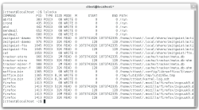

# Kernel Log: New tools and drivers

**Thorsten Leemhuis**

**The tool collection util-linux has been extended to include resizepart, a utility that is useful when repartitioning. Some X.org graphics drivers now support hybrid graphics. The infrastructure to support UEFI Secure Boot is maturing**

Last week Karel Zak [released](http://article.gmane.org/gmane.linux.utilities.util-linux-ng/6394) version 2.22 of util-linux, the tool collection that provides command line programs such as dmesg, fdisk, kill, mount and su to the Linux distributions. This is the first version to include the resizepart program. This tool uses an interface that was [introduced with](http://git.kernel.org/linus/c83f6bf98dc1f1a194118b3830706cebbebda8c4) Linux 3.6 to [inform](http://thread.gmane.org/gmane.linux.kernel/1325114) the kernel when the size of a used partition has changed; when a mounted or otherwise active partition is resized via Fdisk or Parted, this allows the kernel to be informed of the new conditions and the extra space to be used immediately.

  Lslocks displays the files that have been locked by programs Another new addition is lslocks, a tool that, similar to the lslk tool which has not been maintained since 2001, returns a list of locked files; it also displays which program locked a file. Zak provides further background on the program [in a blog posting](http://karelzak.blogspot.de/2012/08/lslocks8.html). Additionally, the new wdctl tool can query the status of the [watchdog hardware](http://en.wikipedia.org/wiki/Watchdog_timer) some systems include to monitor hardware components.

The blkid, findmnt, mount, swapon and umount programs found in util-linux have been extended to include code that allows them to find storage devices by their labels or by their UUIDs (Universally Unique Identifiers) with "PARTLABEL=" or "PARTUUID=". The dmesg program now supports the [changes to the logging mechanisms](../site/open/features/What-s-new-in-Linux-3-5-1637461.html "What's new in Linux 3.5 – 22 July 2012") that were integrated in Linux 3.5; this enables it to offer a "follow" feature which, similar to "tail -f", waits for new kernel messages and outputs them as they arrive. The developers have also integrated the eject, su, sulogin and utmpdump tools into the collection; some of these tools used to be part of the [coreutils](http://www.gnu.org/software/coreutils/) GNU core utilities or [sysvinit](http://savannah.nongnu.org/projects/sysvinit).

### Graphics

- The [recently released X Server 1.13](../site/news/item/X-Server-1-13-has-better-hybrid-graphics-support-1701627.html "X Server 1.13 has better hybrid graphics support – 06 September 2012") includes improvements to the code that supports graphics hardware that can be added at runtime; to use these features for hybrid graphics solutions such as NVIDIA's Optimus technology, they must be supported by the kernel and the libdrm as well as the graphics drivers for the X Server. The developers recently integrated the required changes into the development branches of the Intel, Nouveau and Radeon X.org drivers ([1](http://cgit.freedesktop.org/xorg/driver/xf86-video-intel/commit/?id=d14ff42f2a205542df2ef723c6151d18db2bea8b), [2](http://cgit.freedesktop.org/xorg/driver/xf86-video-intel/commit/?id=6705d8237aca90964449e4dbee97b4f62b87c28b), [3](http://cgit.freedesktop.org/xorg/driver/xf86-video-intel/commit/?id=69827126abdfa289417b55fe7db8ae0535037185), [4](http://cgit.freedesktop.org/nouveau/xf86-video-nouveau/commit/?id=28abba276e36fd0176f416996d44297ddf13f5cd), [5](http://cgit.freedesktop.org/nouveau/xf86-video-nouveau/commit/?id=239f39977ebb64c9d545c6f3c905de3c0ad840d0), [6](http://cgit.freedesktop.org/xorg/driver/xf86-video-ati/commit/?id=3add8df8122697acfe126d4857f3946ce44b8305), [7](http://cgit.freedesktop.org/xorg/driver/xf86-video-ati/commit/?id=f7502a11c8ef9c453ceb40d26109977116df88c2)). Version 2.20.7 of the intel X.org driver, which was [released soon afterwards](http://lists.freedesktop.org/archives/xorg/2012-September/055102.html), already supports PRIME.

<!-- -->

- NVIDIA has [released](http://thread.gmane.org/gmane.comp.freedesktop.xorg.announce/1796) version 0.5 of libvdpau, a wrapper library that allows userspace programs to access the vdpau support offered by some graphics drivers; vdpau gives access to video acceleration features in modern GPUs.

<!-- -->

- Almost ten months after the introduction of the first Radeon graphics cards with [Southern Islands graphics chips](http://xorg.freedesktop.org/wiki/RadeonFeature#Decoder_ring_for_engineering_vs_marketing_names), the developers have yet to release any Mesa 3D or X.org graphics drivers for the GPUs that are used on series 7750 to 7970 Radeon HD cards. Recently, however, AMD developer Christian König proudly [announced](http://thread.gmane.org/gmane.comp.video.mesa3d.devel/45138) that the radeonsi Mesa 3D driver now passes almost all quick-driver tests of the [piglit](http://people.freedesktop.org/~nh/piglit/) OpenGL test software. This Gallium-based Mesa 3D driver is to become the basis of a simple X.org driver that will leave most of the work to radeonsi and to the Linux kernel's KMS graphics driver.

<!-- -->

- The Mesa developers have now [made the jump](http://cgit.freedesktop.org/mesa/mesa/commit/?id=0791484c4233f3b474b1d9ba1af2f4608fe7e962) to version 9.0 that was previously [mentioned in the last regular Kernel Log](../site/open/features/Kernel-Log-NVIDIA-updates-graphics-drivers-1678863.html "Kernel Log: NVIDIA updates graphics drivers – 30 August 2012"). The developers [also mentioned](http://thread.gmane.org/gmane.comp.video.mesa3d.devel/45156/) an idea to modify the glxinfo diagnostic program in such a way that it returns OpenGL 3.1 support even if the open source drivers that have the required capabilities don't support the [GL_ARB_compatibility](http://www.opengl.org/registry/specs/ARB/compatibility.txt) extension that is specified in 3.1. The proprietary graphics drivers by AMD and NVIDIA already support this compatibility extension.

<!-- -->

- The development branch of Mesa 3D now [includes](http://cgit.freedesktop.org/mesa/mesa/commit/?id=3433471e8b46dd9dd042a00f88ef9ad011a94aac) code that allows the Nouveau driver to generate machine code for NVIDIA's GK110. With this addition, the Mesa developers have provided the foundations to support the second generation of NVIDIA's Kepler architecture; however, rather than on graphics cards, the GK110 is initially planned to be used with computing accelerators such as the Tesla K20 that are expected to become available in December.

### Linux kernel

-  In a [blog posting](http://mjg59.dreamwidth.org/16863.html), Matthew Garrett provides an overview of the development status of the Linux code to support UEFI Secure Boot. According to the developer, the infrastructure for signing the boot loader has now been implemented. Garret has also submitted various kernel patches that are designed to prevent the modification of a running kernel [to the LKML for review](http://thread.gmane.org/gmane.linux.kernel/1352570). The development of kernel extensions for signing kernel modules has recently also [started to progress again](http://thread.gmane.org/gmane.linux.kernel.lsm/16849/focus%3D16982).

<!-- -->

- Linus Torvalds has [released](http://thread.gmane.org/gmane.linux.kernel/1355380) the fifth release candidate of Linux 3.6 and expressed a certain amount of surprise at the small number of modifications he received.

<!-- -->

- Developer Mel Gorman, who mainly works on the kernel's memory management code, has [released](http://thread.gmane.org/gmane.linux.kernel.mm/85523) version 0.05 of his MMTests benchmark suite.

<!-- -->

- The [recently released](http://article.gmane.org/gmane.linux.kernel/1355315) version 1.2.0 of the [sysprof](http://sysprof.com/) tracing software offers various user interface and performance improvements.

### Userland

- [The ALSA project](http://www.alsa-project.org/) has released version 1.0.26 of its libraries, tools and plug-ins; the [changelog](http://www.alsa-project.org/main/index.php/Changes_v1.0.25_v1.0.26) describes all new features. The developers have not updated the audio driver package – therefore, the most recent audio drivers are currently only available within the release candidates of Linux 3.6, but not from the ALSA project.

<!-- -->

- The developers of the [Hplip](http://hplipopensource.com/) (Hewlett-Packard's Linux Imaging and Printing Software) project have released version 3.12.9 of their driver framework, which can address more than two thousand printers and multi-function devices that are mostly made by HP. According to the [release notes](http://sourceforge.net/news/?group_id=149981&id=309222), new additions include code to support the 3510, 3511 and 3512 DeskJet models, the 3515, 3516 and 6525 DeskJet Ink Advantage devices and the 6520, 6525, 7520 and 7525 Photosmart models.

### LKML

- Five seats on the Linux Foundation's [Technical Advisory Board](http://www.linuxfoundation.org/programs/advisory-councils/tab) (TAB) were up for re-election after this year's Kernel Summit; [they were won by](http://article.gmane.org/gmane.linux.kernel/1351027) main Btrfs developer Chris Mason, SCSI subsystem maintainer James Bottomley, Wi-Fi subsystem maintainer John W. Linville, Red Hat storage expert Ric Wheeler and Intel graphics driver developer Jesse Barnes.

<!-- -->

- Audio driver developer Takashi Iwai recently [explained](http://thread.gmane.org/gmane.linux.kernel/1349296/focus%3D100499) how to compile modified source code of a kernel driver in such a way that it works with the kernel the Linux distributor provided.

*Further background information about the developments in the Linux kernel area can be found using [the search function](../site/search/?sort=d;rm=search;mediatype=3;q=kernel-log) at [The H Open Source](../site/open/). Information about previous Linux kernel releases can be found in [The H's Linux Kernel History](../site/open/features/The-H-s-Linux-Kernel-History-1221120.html "The H's Linux Kernel History – 15 July 2011"). New editions of Kernel Logs are also mentioned on [Identi.ca](http://identi.ca/kernellog2) and [Twitter](http://twitter.com/#!/kernellog2) by @kernellog2. The Kernel Log author also posts updates about various topics on [Identi.ca](http://identi.ca/kernellogauthor) and [Twitter](http://twitter.com/#!/kernellogauthor) as @kernellogauthor.*
